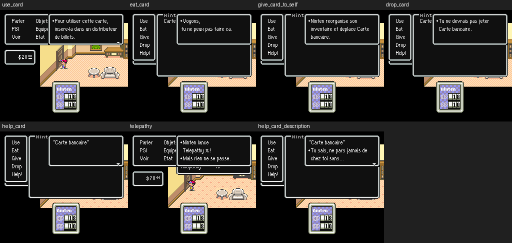

# V63 — premiers accès de texte observés en jeu

Sept parcours d'inventaire et de PSI ont été rejoués avec les deux profils V61, soit **14 essais Snes9x et 10 488 images échantillonnées**. Les messages examinés sont français. Aucun résidu de texte à corriger n'a été trouvé dans ce lot. Le patch à appliquer reste V61 ; aucun IPS V63 n'est créé.

## Résultat des parcours

Les deux profils suivent les mêmes adresses. Chaque parcours repart du même état après le premier combat, puis utilise uniquement la manette. Aucune redirection de script, aucun callback temporaire et aucune écriture directe en WRAM.

| Parcours | Images par profil | Curseurs ROM distincts | Hors intervalles du graphe V62 | Affichage relu |
|---|---:|---:|---:|---|
| Utiliser la carte | 580 | 71 | 0 | Instructions du distributeur |
| Manger la carte | 654 | 34 | 34 | « Voyons, tu ne peux pas faire ça. » |
| Donner la carte à soi-même | 802 | 43 | 40 | Réorganisation de l'inventaire |
| Jeter la carte | 802 | 28 | 28 | Refus de jeter la carte |
| Aide : titre | 876 | 5 | 5 | « Carte bancaire » |
| Télépathie | 580 | 38 | 24 | « Mais rien ne se passe. » |
| Aide : description | 950 | 52 | 52 | « Tu sais, ne pars jamais de chez toi sans… » |

Les colonnes comptent des positions du curseur, pas des textes distincts ni un pourcentage. Les cas d'aide partagent des positions. Les commandes d'action Use/Eat/Give/Drop/Help! restent anglaises et appartiennent au lot menus demandé après les textes.

## Ce que l'observation apporte

Le pointeur courant est lu dans la pile DISPLAY_TEXT après chaque image. L'adresse appelée peut donc être observée même si son appelant n'apparaît pas dans le graphe statique. Les messages traduits de consommation (`330EE5–330F06`), réorganisation (`330B11–330B42`), refus de jeter (`320A51–320A6E`), aide (`357046–35707C`) et Télépathie (`2552A1–2552B7`) sont atteints pendant ces actions normales.

Les traces montrent aussi des positions de commandes et de fin de script : `07E401–07E404`, `07E42B`, `38E7C0`, `37A96D`. Elles ne prouvent pas la lecture des chaînes anglaises voisines. Une adresse hors graphe peut également venir d'un appel direct dont la graine manque ; V63 ne démontre pas la formule d'adresse de chaque appelant assembleur.

Les états, ROM et cœur restent privés. Les ancres binaires du moteur, empreintes des fichiers et résultats numériques permettent de contrôler la méthode sans distribuer ces fichiers.

## Validation et limites

- 14 parcours terminés sans erreur ; 14 captures 256 × 224 relues, avec empreintes RGB vérifiées.
- 4 contrôles V63 passent : cadres inactifs ignorés, sélection du cadre courant, rejet d'une capture invalide, cohérence des traces publiées.
- 7 contrôles V62 hors ROM passent également. Les 575 tests historiques ne sont pas réexécutés pour ce lot sans modification de ROM.
- Point de sauvegarde : branche `work/v63-live-accesses`, commit `e84c0da04019c5aa430940b26963c411392141fb`.

L'échantillonnage par image peut manquer un appel terminé pendant l'image. Le chargement d'un état ne remplace pas une partie complète. Les branches à plusieurs personnages, les inventaires pleins/vides, les services et le combat restent à examiner. **100 % des textes visibles n'est toujours pas certifié.**

- [Méthode et reproduction](tools/v63/README_V63.md)
- [Traces accents](tests/emulation_v63/results_accents.json)
- [Traces ASCII](tests/emulation_v63/results_ascii.json)
- [Comparaison au graphe V62, accents](tools/v63/live_audit_accents.json)
- [Comparaison au graphe V62, ASCII](tools/v63/live_audit_ascii.json)

