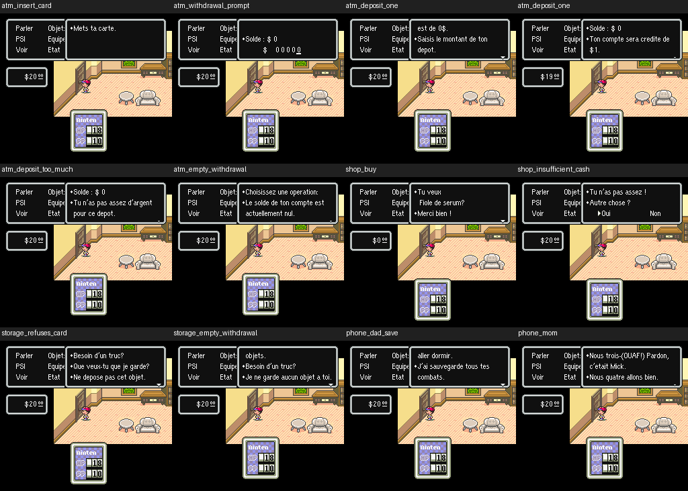

# V64 — corrections bancaires et essais des services

**Quatre fragments bancaires encore anglais sont traduits.** V64 est un IPS autonome à appliquer directement à la ROM originale USA 1.2, avec accents ou ASCII.

| Adresse | Ancien texte | Traduction |
|---|---|---|
| 0680B0 | Please insert your ATM card. | Mets ta carte. |
| 38247B | Balance: $ | Solde : $ |
| 3824A7 | Please enter the amount of your deposit. | Saisis le montant de ton dépôt. |
| 3824D2 | Balance: $ | Solde : $ |

Les remplacements conservent la taille de chaque plage, avec des espaces finaux si nécessaire. Aucun pointeur ni commande modifié, aucune allocation ; empreintes des sprites identiques à V61. Les IPS contiennent tous les enregistrements V61, suivis de quatre remplacements.

## Pourquoi l'audit précédent les manquait

Dix-sept lignes NPC utilisent encore les racines originales du distributeur `0680A6`/`0680C2`, sous la plage retenue par les graines V62. V64 les suit explicitement : 20 scripts, 30 références, aucun script bloqué. La plupart des messages étaient déjà français ; les quatre fragments ci-dessus ne l'étaient pas.

Cet élargissement ne constitue pas un audit de toutes les anciennes racines NPC. D'autres services et appelants assembleur restent à examiner.

## Affichage et branches

Treize cas par profil donnent **26 essais retenus, 26 964 images échantillonnées et 122 captures relues**. Six essais V61 supplémentaires fournissent 22 captures de référence : les 22 comparaisons ne changent que la fenêtre de texte. Les fichiers et le recalcul des différences sont dans le dépôt.

| Service | Vérification obtenue |
|---|---|
| Banque | Retrait refusé sur compte nul, dépôt de 1 $, dépôt de 30 $ refusé avec 20 $ en poche, annulation |
| Invites bancaires | Invitation de carte et consigne de retrait lues isolément, pour les quatre corrections |
| Téléphone | Choix Papa/Maman, dialogue de sauvegarde de Papa, début de conversation Maman, annulation |
| Boutique | Achat d'une Fiole de sérum à 20 $, puis réponse de manque d'argent pour un objet plus cher |
| Stockage | Carte bancaire refusée, réponse de stock vide |

L'achat montre 20 → 0 $ en poche ; le dépôt montre 20 → 19 $ et une confirmation de 1 $. Ces effets sont constatés à l'écran, sans prétendre avoir contrôlé leurs champs numériques de WRAM.

**L'entrée est forcée vers le script complet du service**, via quatre octets temporaires de l'action carte bancaire. Les choix suivants sont exécutés par la manette et le moteur d'origine. Ces tests ne prouvent pas l'accès naturel sur la carte. Deux cas sont de simples lectures isolées, identifiées comme telles. Le téléphone de la maison ne donnait que Biiip/R.A.S. dans le parcours essayé ; aucune conversation naturelle n'est revendiquée.

## Contrôles et suite

585 tests passent : 575 historiques, 4 V63, 2 V64 avec ROM et 4 V64 hors ROM. Les contrôles V64 couvrent les seules plages autorisées, les commandes et sprites, le graphe ATM, l'intégrité des captures et la cohérence des traces. Le recalcul Pillow confirme les 122 empreintes RGB et les 22 différences cantonnées à la fenêtre de texte.

Checkpoint du constructeur et des quatre corrections : `work/v64-services`, commit `76aa3ce617549fe2d26e87d8ff35e764081e081e`.

Restent notamment le retrait avec un solde positif, le stockage d'un objet autorisé puis sa récupération, les inventaires pleins, les autres enseignes et les accès naturels. Les conversations Maman et Papa ne sont pas toutes déroulées jusqu'au raccrochage. **100 % des textes visibles n'est pas certifié.**

- [Méthode, sources et reproduction](tools/v64/README_V64.md)
- [Traces accents](tests/emulation_v64/results_accents.json)
- [Traces ASCII](tests/emulation_v64/results_ascii.json)
- [Comparaisons V61/V64](tests/emulation_v64/comparison_v61.json)

