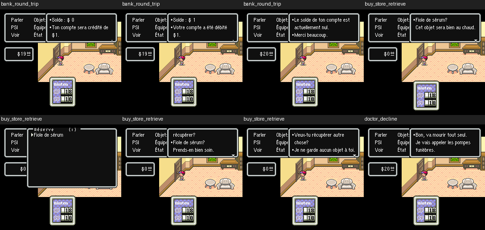

# V65 — dépôt et récupération d'objets

V65 retire l'article anglais dans les deux confirmations de stockage, découvertes pendant un cycle complet d'achat, dépôt puis récupération. La phrase de dépôt devient « Cet objet sera bien au chaud. » afin de convenir à tous les noms d'objets.

| Situation | V64 | V65 |
|---|---|---|
| Dépôt | The Fiole de sérum ? Je le garderai bien au chaud. | Fiole de sérum ? Cet objet sera bien au chaud. |
| Récupération | The Fiole de sérum ? Prends-en bien soin. | Fiole de sérum ? Prends-en bien soin. |

Le moteur de classification et ses branches sont conservés dans un auxiliaire privé ; l'auxiliaire partagé n'est pas modifié. La récupération utilisait une ancienne copie qui chevauche des sprites : sept scripts sont déplacés vers le remplissage protégé, avec leurs commandes conservées. La banque 25 reste strictement identique à V64 et les empreintes des sprites sont inchangées. Les IPS autonomes prolongent V64 avec 17 enregistrements supplémentaires, sans changer la taille de la ROM.

## Essais et résultats

Six essais principaux, trois scénarios dans chaque profil, couvrent 17 216 images échantillonnées et 84 captures relues. Deux reprises V64 du cycle de stockage fournissent 40 captures appariées : seules les fenêtres de texte changent.

- Banque : dépôt de 1 $, retrait de ce dollar, puis nouvel essai de retrait refusé sur compte redevenu nul. La poche passe de 20 à 19 puis revient à 20 $.
- Stockage : achat d'une Fiole de sérum à 20 $, dépôt confirmé, réserve contenant un objet, récupération confirmée, puis réponse indiquant une réserve vide.
- Soigneur : devis et branche de refus en français. La piste « you have » est classée comme un faux positif provenant d'un décodage traversant des paramètres de commandes.

Les effets sont constatés dans l'interface du jeu, sans lecture dédiée des champs numériques du compte ou de l'inventaire. Les scripts de services sont **appelés artificiellement** par un wrapper privé ; les choix suivants utilisent le moteur et la manette. Aucun accès naturel à ces lieux sur la carte n'est revendiqué.

593 tests passent : 575 historiques, 4 V63, 6 V64 et 8 V65. Les contrôles V65 couvrent les écritures autorisées, les blocs relocalisés, leurs commandes et sauts, les cinq branches de l'auxiliaire, les sprites, la piste du soigneur et les traces/captures publiées. Le contrôle d'affichage recalcule les 84 empreintes RGB et les 40 comparaisons.

Deux checkpoints protègent le travail : `work/v65-storage` pour la première correction, puis `work/v65-storage-safe` (`a3081132ab378f643d36ebfaa1e6e230e179b6e6`) pour le lot final avec relocalisation protégée.

Restent les inventaires et réserves pleins, plusieurs personnages, les autres services/enseignes, les appels téléphoniques complets et les parcours naturels. Les appelants calculés non observés et les autres anciennes racines NPC ne sont pas tous couverts. **100 % des textes visibles n'est toujours pas certifié.**

- [Sources et reproduction](tools/v65/README_V65.md)
- [Traces accents](tests/emulation_v65/results_accents.json)
- [Traces ASCII](tests/emulation_v65/results_ascii.json)
- [Comparaisons avec V64](tests/emulation_v65/comparison_v64.json)

