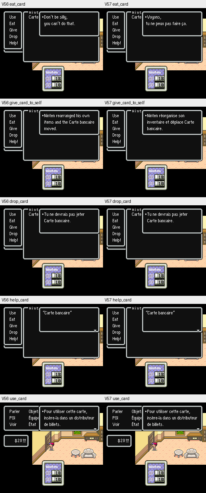
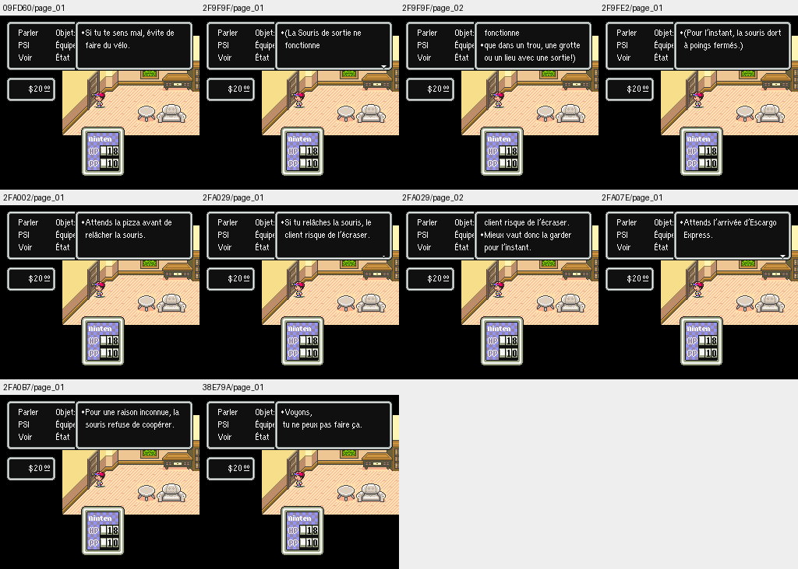
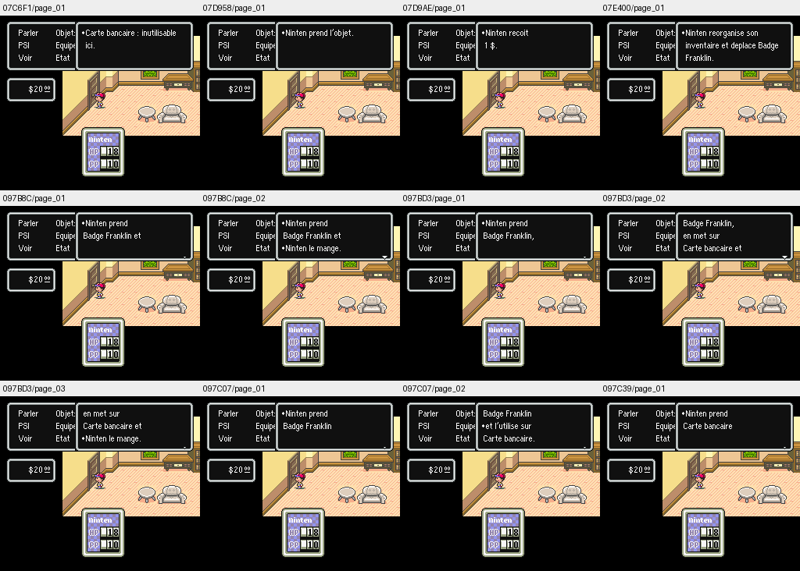
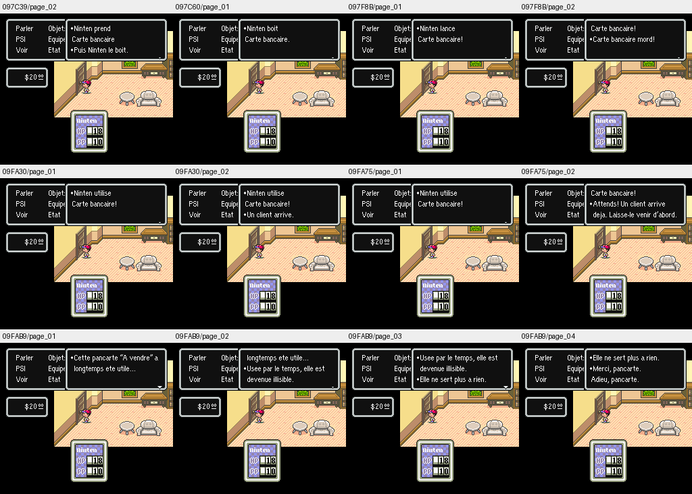

# V57 — vérification d’affichage

Les deux profils, accents et ASCII, ont été vérifiés sous Snes9x 1.63. **480 tests passent**, dont 29 propres à V57 (12 sur ROM et 17 hors ROM) et 451 tests historiques. Les suites graphiques V36/V37 nécessitant CoilSnake ne sont pas exécutées ; leurs tests hors ROM restent inclus.

## Comparaison avec V56

Les quatre reprises du parcours de référence (V56/V57, deux profils) produisent **212 captures identiques** : 109 avec accents et 103 en ASCII. Les empreintes des sprites analysés restent identiques à V56. La corruption observée pendant le développement est absente du patch final ; cela ne certifie pas tous les graphismes hérités.

Les **20 essais naturels** comparent cinq opérations sur la carte bancaire dans les deux versions et les deux profils, sans modification de ROM ni de WRAM. Sur dix comparaisons, les quatre réponses « manger » et « donner à soi-même » changent uniquement dans le rectangle du texte (104, 16, 244, 65). Les six réponses « jeter », « aide » et « utiliser » sont identiques en pixels.

## Lectures contrôlées

Les **46 essais contrôlés** couvrent 23 contextes dans chaque profil. Seul l’opérande de routage de quatre octets à 368B51 est redirigé ; la WRAM reste intacte. Ils vérifient le rendu et les commandes de texte, sans prouver la disponibilité naturelle des objets ni leurs effets. Certains champs dynamiques non initialisés peuvent afficher « Aucun ». Certains messages se ferment avant la capture finale ; les captures intermédiaires sont conservées dans les résultats de lecture.

Les 66 essais d’affichage terminent sans erreur. Les huit planches ci-dessous ont été relues dans les deux profils : aucun débordement observé sur ces captures. Ces essais ne constituent pas une validation du jeu entier ni de tous ses embranchements.

## Captures

### Opérations normales : V56 à gauche, V57 à droite

### Textes contrôlés avec accents

### Textes contrôlés ASCII

## Reproduction

Les scripts `replay.py`, `probe.py` et `compare_results.py` accompagnent les résultats JSON. La ROM originale USA 1.2, le cœur Snes9x et les états de départ sont fournis localement par le testeur et ne sont pas distribués. Voir les options `--help` des scripts et le [guide V57](../../tools/v57/README_V57.md).
