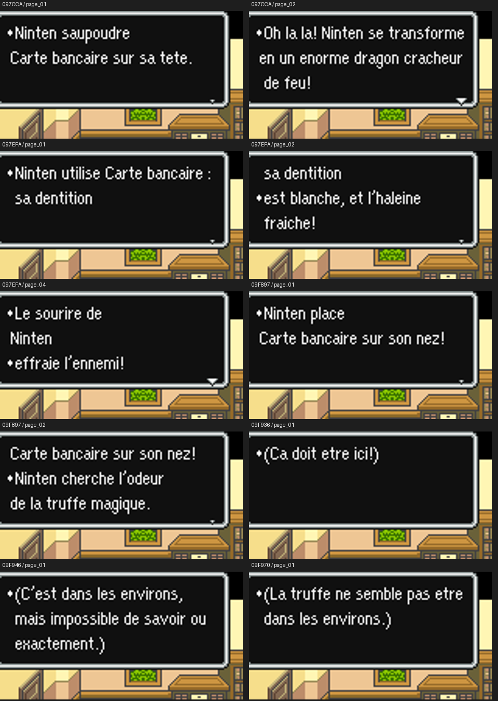
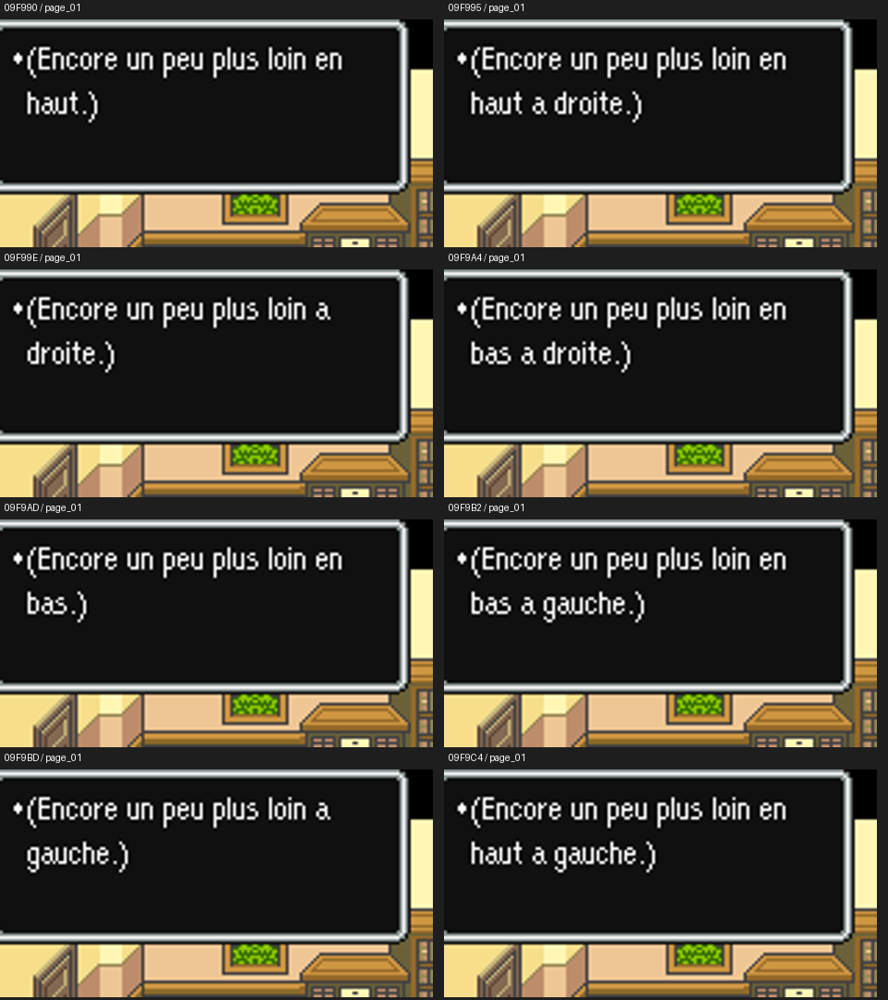

# V58 — affichage contrôlé et régression

Snes9x 1.63, profils accents et ASCII. **511 tests locaux réussis** : 480 historiques, 12 V58 sur ROM et 19 V58 hors ROM. Les suites graphiques V36/V37 qui exigent CoilSnake restent exclues ; leurs tests hors ROM sont inclus.

Les quatre reprises V57/V58 du parcours de référence donnent **212 images identiques** (109 accents, 103 ASCII). Les résultats V58 identifient les empreintes finales des deux ROM privées. Les 464 groupes et 4 177 références d’images des sprites restent identiques à V57.

**28 essais contrôlés** terminent sans erreur : 14 contextes par profil. Ils modifient l’opérande de l’action carte bancaire, sans intervention du testeur sur la WRAM. Pour les huit suffixes de direction, un wrapper temporaire ajoute le préfixe français, un appel et une attente : un retour direct sans attente rendait ces messages trop brefs pour une capture lisible. Cette adaptation est décrite dans les métadonnées et absente des patchs finaux.

La carte bancaire visible est un support de lecture. Ces essais ne signifient pas qu’elle transforme le héros, blanchit ses dents ou trouve des truffes. Les modèles hérités ne sont pas confirmés comme naturellement accessibles dans le portage. La sélection réelle des huit directions et les effets de jeu ne sont pas validés.

Les quatre planches ont été relues : pas de débordement observé sur ces captures. Les pauses et retours de ligne d’origine sont conservés. Les résultats complets se trouvent dans `display_results.json`, `results.json` et `comparison_v57.json`.

Voir [les commandes de reproduction](../../tools/v58/README_V58.md). ROM, états et cœur d’émulation doivent être fournis localement ; ils ne sont pas distribués.
