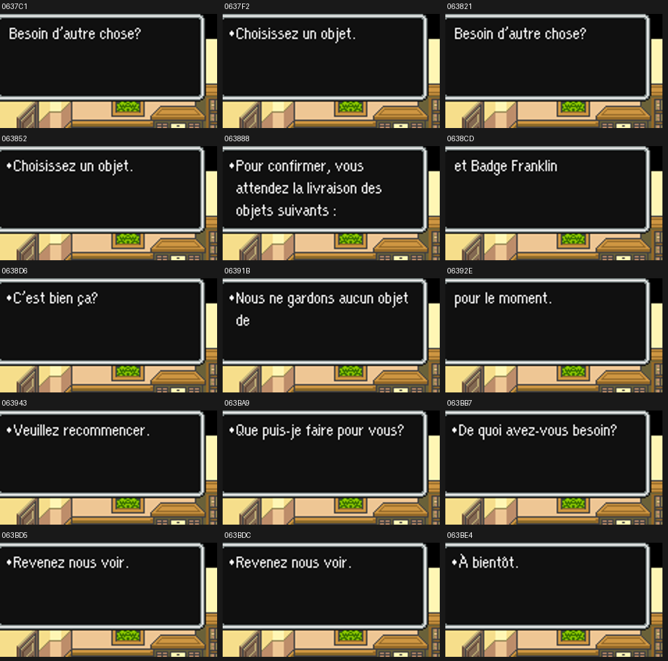
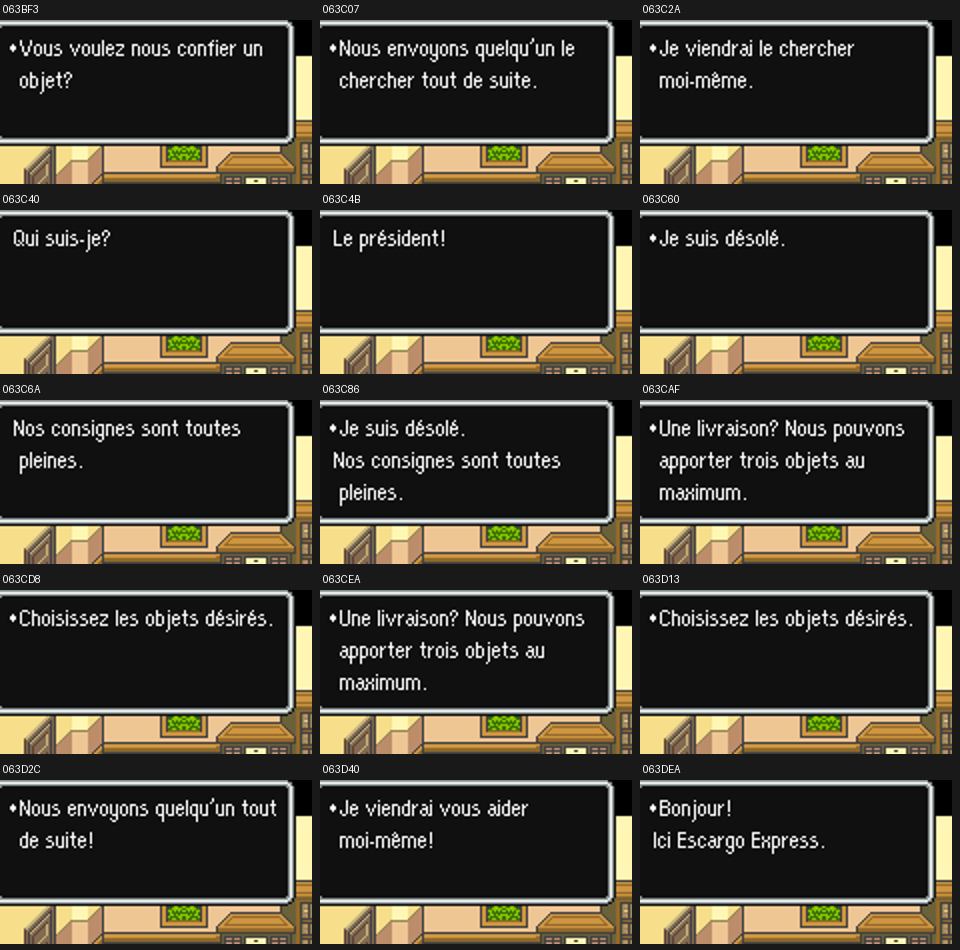
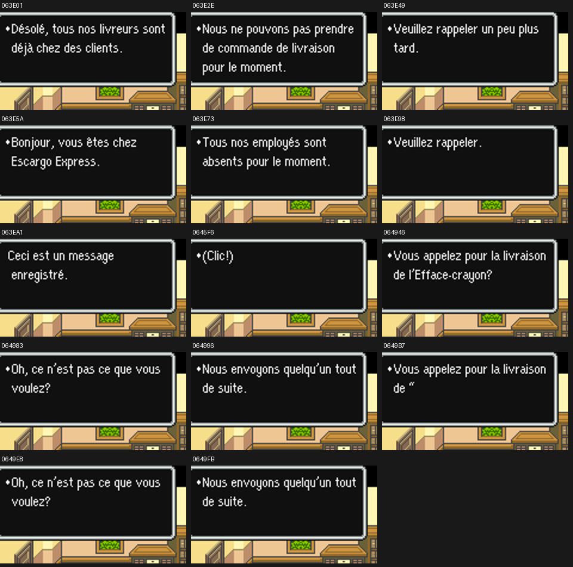
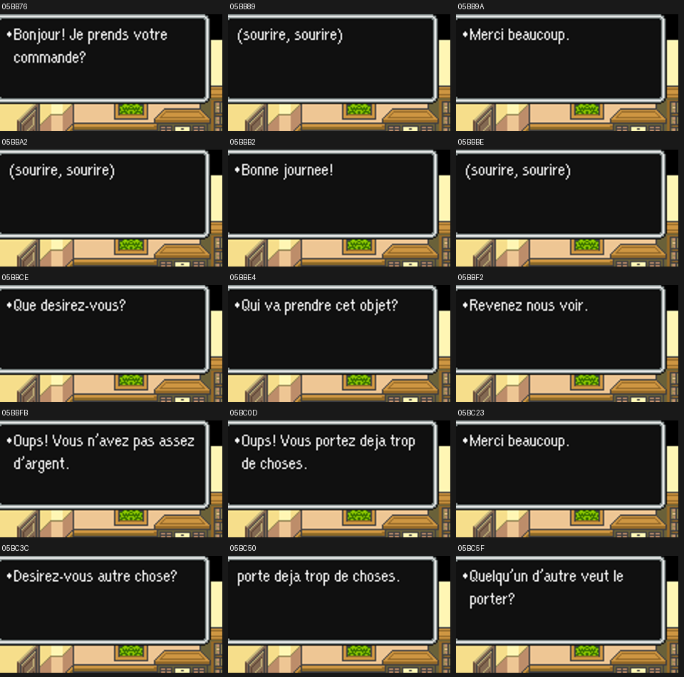
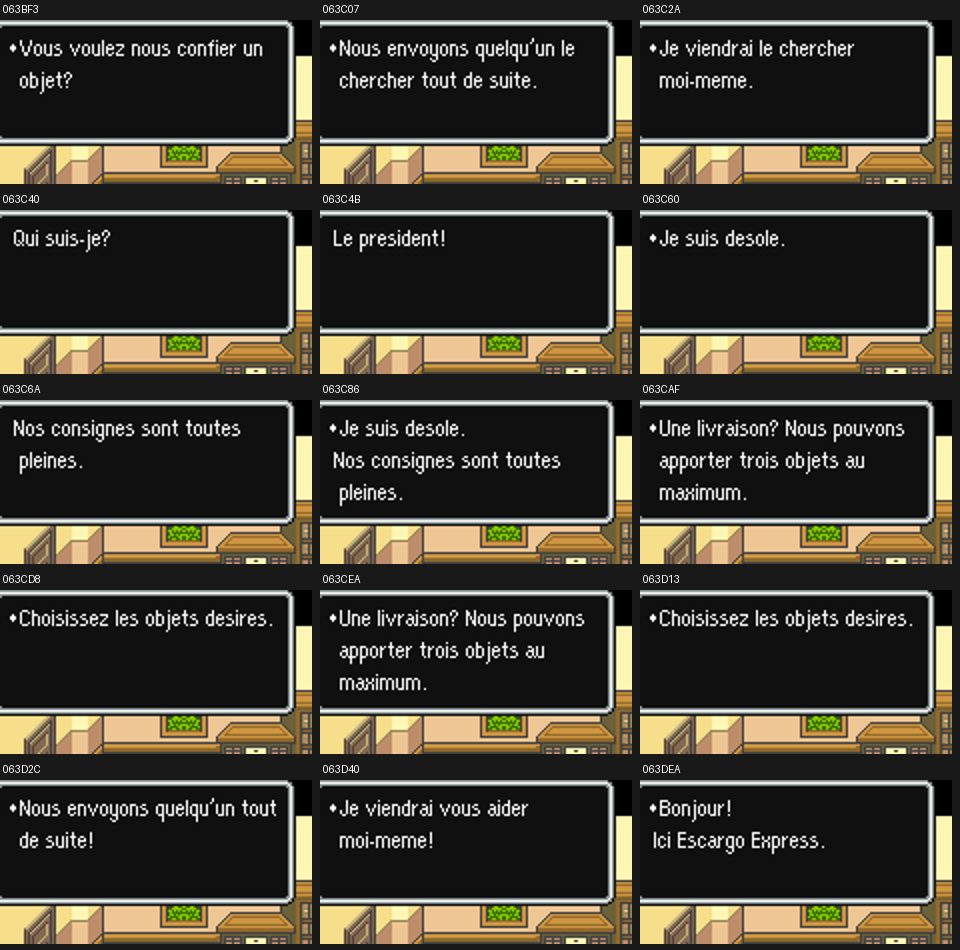

# V59 — affichage et régression

Snes9x 1.63, profils accents et ASCII. **537 tests réussis**, dont 26 propres à V59. Les suites graphiques V36/V37 nécessitant CoilSnake sont exclues ; leurs tests hors ROM restent inclus.

Les **212 captures** du parcours de référence sont identiques à V58 (109 accents, 103 ASCII). Les **118 lectures isolées**, une par zone et par profil, se terminent sans erreur. Les huit planches ci-dessous ont été relues : aucun débordement observé.

Les sauts d’entrée et le texte des copies correspondent aux IPS finaux. Le probe ajoute une pause et remplace temporairement le saut de reprise par un retour pour lire chaque zone séparément. Les variables de porteur ne sont pas toujours initialisées ; le nom d’objet peut provenir de l’inventaire du point de départ. Ces essais ne vérifient ni la continuité visuelle de tous les dialogues complets, ni leurs conditions, paiements ou livraisons. Les commandes et chemins d’entrée/reprise sont aussi vérifiés statiquement. Les modifications de test ne sont pas publiées dans les patchs.

Voir les résultats JSON et le [guide de reproduction](../../tools/v59/README_V59.md).

