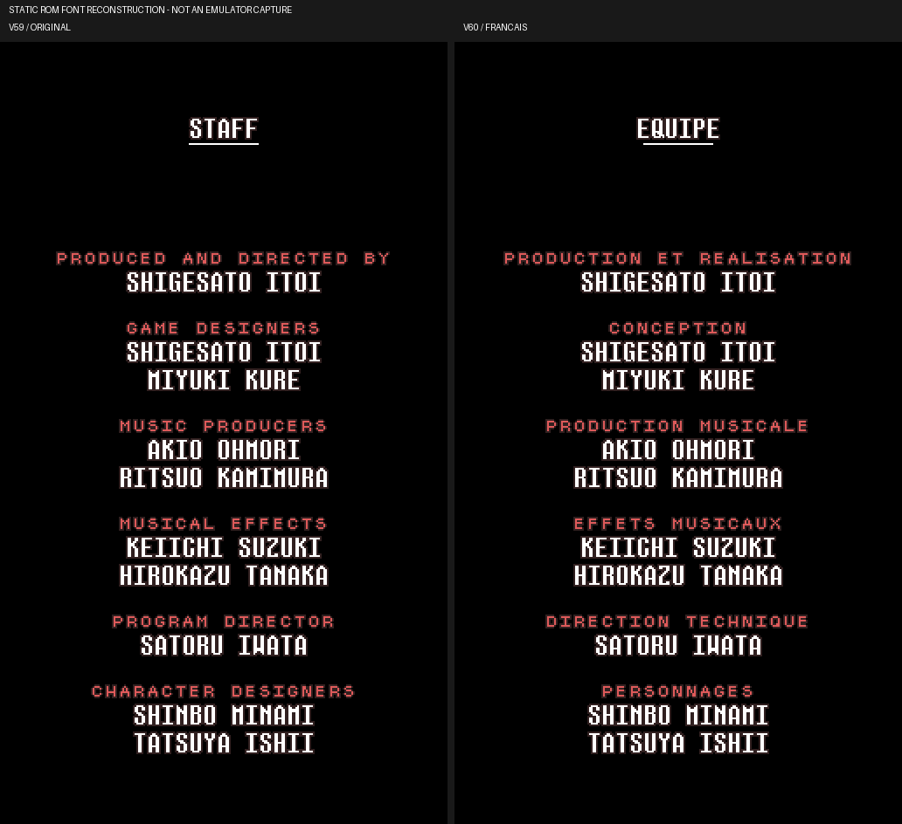
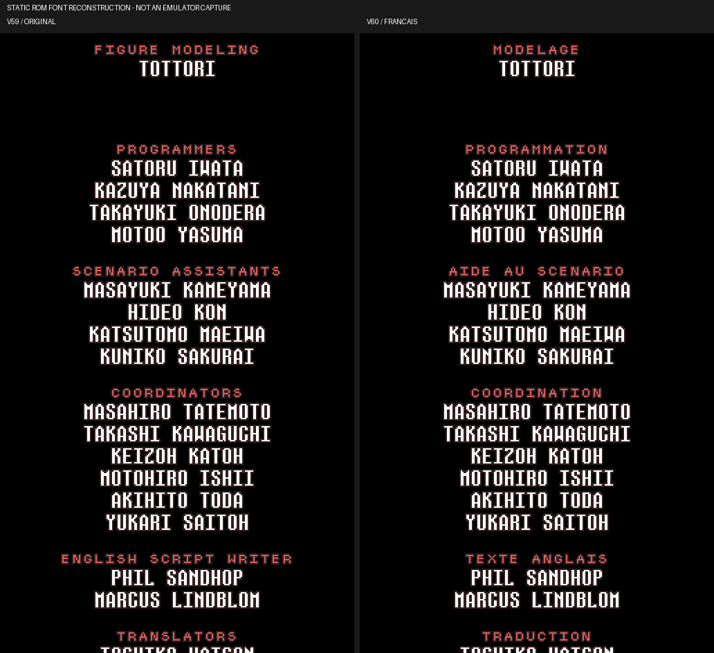
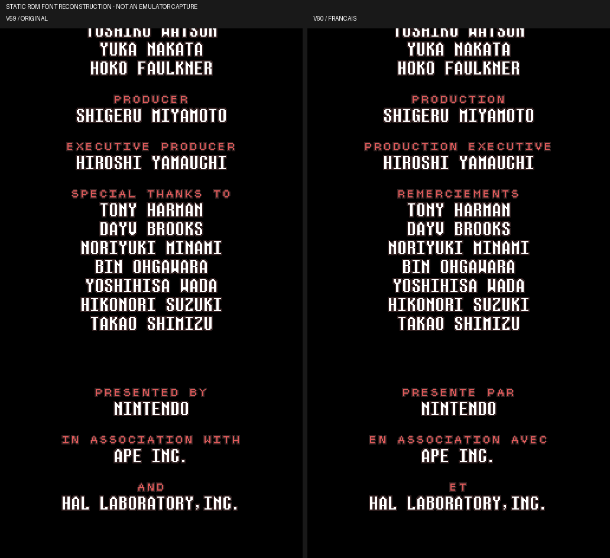
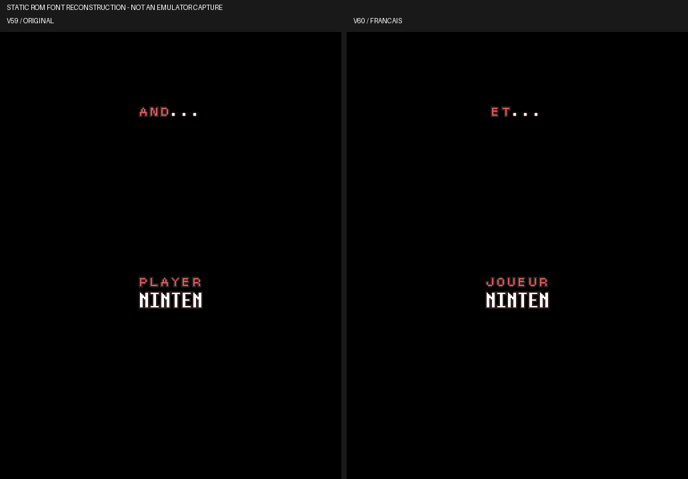

# V60 — tests, parcours et générique

**554 tests locaux réussis** : 537 historiques et 17 V60. Les deux reprises Snes9x 1.63 produisent **212 captures identiques à V59**, 109 avec accents et 103 en ASCII. `results.json` et `comparison_v59.json` enregistrent les empreintes des ROM privées et la comparaison. Ces reprises ne parcourent pas la fin de partie.

La vérification du générique lui-même est **statique**, avec sa vraie police 2 bpp et ses palettes. Les quatre planches source/français ont été relues : les 21 intitulés sont lisibles, dans les 32 cases autorisées, et les noms sont conservés. Les styles, espaces, champ joueur et hauteur totale sont identiques. Le français termine 22 octets avant l’ancienne fin ; le moteur atteint son nouveau `FF` sans lire les anciens octets après lui.

Ces images ne certifient pas le défilement dans le moteur ni l’accès naturel au générique. Une fin de partie complète reste à vérifier. L’exemple de nom du joueur est « NINTEN ». Les sections d’image peuvent couper une ligne à leur frontière ; elles proviennent d’un même panneau vertical reconstitué.

Voir [le guide de reproduction](../../tools/v60/README_V60.md). Aucun fichier ROM, état de jeu ou cœur d’émulation n’est distribué.
