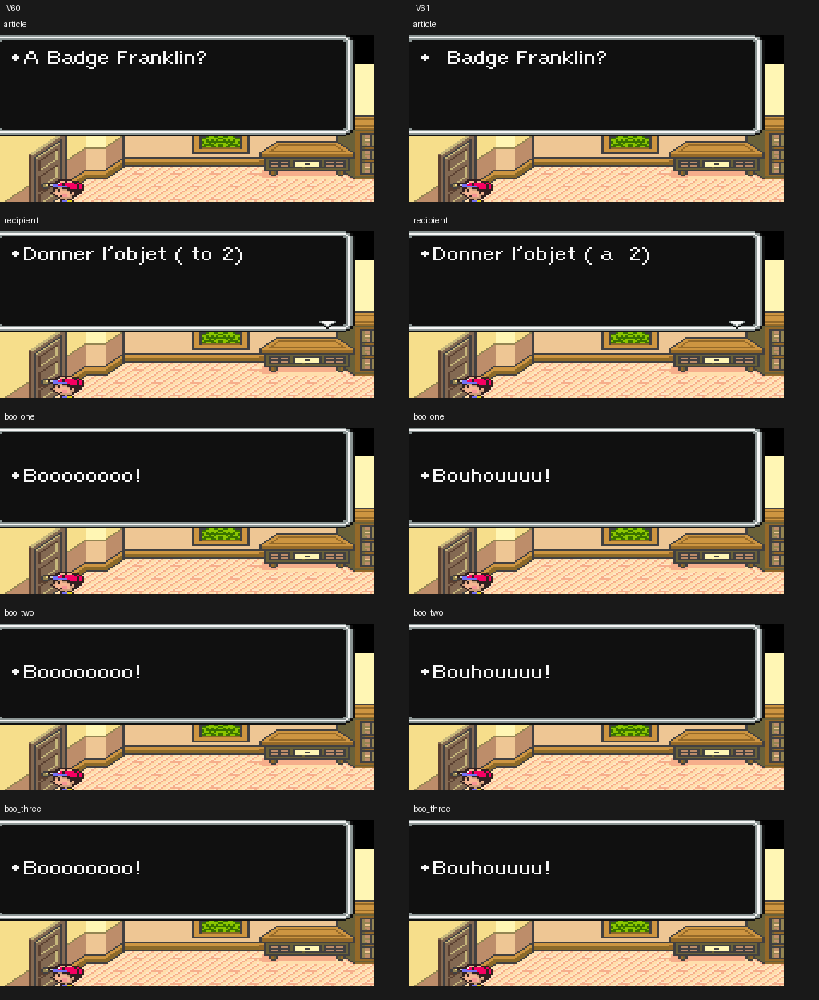

# V61 — affichage et commandes

Snes9x 1.63, profils accents et ASCII. **564 tests locaux réussis** : 554 historiques et dix propres à V61. Les suites graphiques V36/V37 nécessitant CoilSnake restent exclues ; leurs tests hors ROM sont inclus.

Les reprises V60/V61 du parcours de référence donnent **212 captures identiques**, 109 accents et 103 ASCII. Les résultats enregistrent les empreintes des deux ROM privées. Les **20 lectures contrôlées** (cinq cas, deux versions, deux profils) terminent sans erreur. Pour les **dix comparaisons**, les différences restent dans le rectangle du texte ; tous les autres pixels sont identiques. Les deux planches ont été relues : aucun débordement observé.

L’article anglais disparaît et la préposition devient « à » / « a ». La formule de destinataire n’est pas initialisée comme dans sa scène naturelle et imprime « 2 » dans ce test ; ce chiffre n’est pas un nom de personnage validé. Le nom d’objet est celui disponible dans le contexte de lecture. Les trois cris restent temporisés lettre par lettre. Les commandes et leurs opérandes sont aussi comparés statiquement.

Les wrappers ne modifient ni les scripts ni les données de jeu de la WRAM ; seuls l’opérande d’action de carte bancaire et le wrapper temporaire sont changés dans la ROM de test. Les deux derniers cris sont lus directement au même type de début de séquence que le premier. Aucun accès naturel au spectacle, au don ou à la confirmation depuis leurs personnages n’est revendiqué.

[Reproduction et limites](../../tools/v61/README_V61.md). ROM, états et cœur d’émulation ne sont pas distribués.
