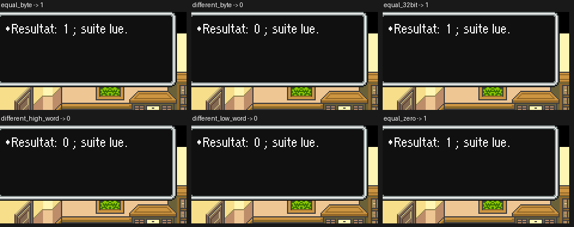

# V62 — comparaison 32 bits et lecture du script suivant

Snes9x 1.63, profils accents et ASCII. **Douze essais synthétiques réussis**, six par profil. Les valeurs du résultat sont vérifiées automatiquement par lecture des registres de travail et d’argument de la fenêtre active. Les deux planches ont aussi été relues : le nombre attendu et « suite lue. » sont visibles dans chaque cas, sans débordement observé.

| Cas | Valeur gauche | Valeur droite | Résultat |
|---|---:|---:|---:|
| Égalité sur un octet | 5 | 5 | 1 |
| Différence sur un octet | 5 | 7 | 0 |
| Égalité 32 bits | `12345678` | `12345678` | 1 |
| Mot haut différent | `00000001` | `00010001` | 0 |
| Mot bas différent | `00010002` | `00010001` | 0 |
| Égalité de zéro | 0 | 0 | 1 |

Les valeurs en code fixe sont hexadécimales. Le test passe par le vrai handler moteur, dont les octets sont vérifiés. Les registres d’entrée sont initialisés par deux callbacks temporaires de retour de constante. L’outil lit la WRAM mais ne l’écrit pas directement. L’action de carte bancaire et trois plages de remplissage sont modifiées seulement dans la ROM de test. Il ne s’agit pas d’un don, retrait, stockage ou autre opération naturelle d’inventaire ; leurs conditions et effets restent à vérifier.

Les résultats `results_accents.json` et `results_ascii.json` conservent les valeurs lues, empreintes, scripts de test et retours de processus. Les données brutes de WRAM, les états, le cœur et les ROM ne sont pas distribués.

**575 tests locaux passent**, dont onze V62 et 564 historiques. Aucun nouveau parcours de référence n’est revendiqué pour V62 : ses IPS sont exactement ceux de V61. Le bénéfice est la lecture complète des deux routines auparavant bloquées, sans changement de la ROM publiée.

[Reproduction](../../tools/v62/README_V62.md).
